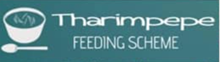
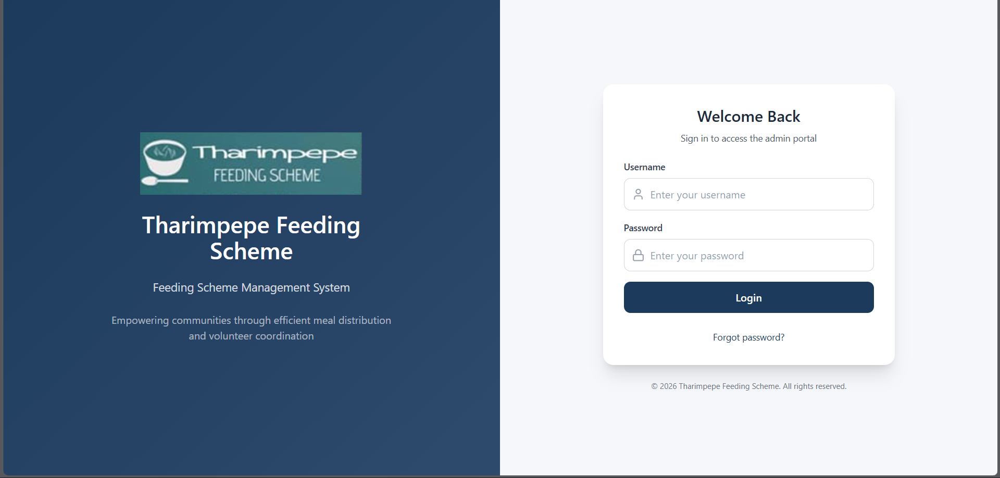
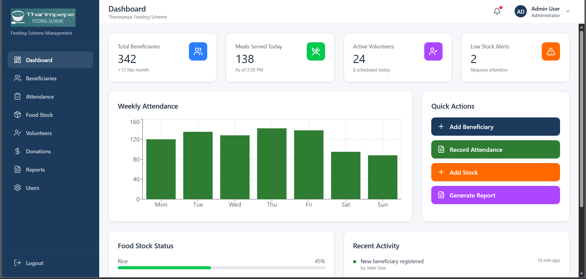
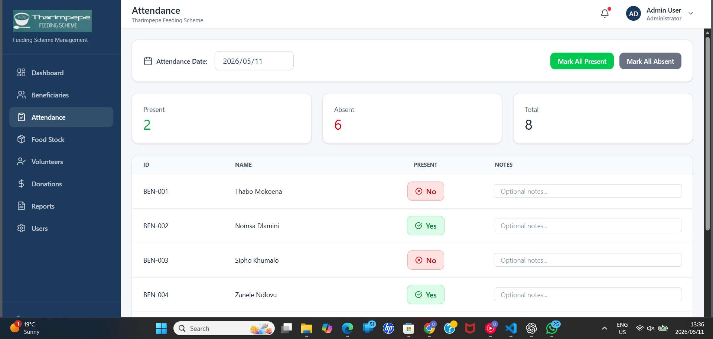
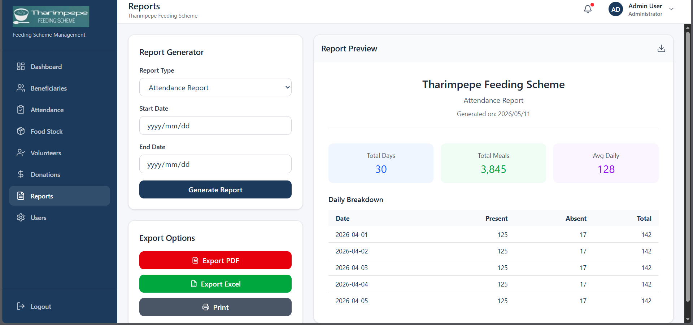

# THARIMPEPE FEEDING SCHEME

## FEEDING SCHEME MANAGEMENT SYSTEM

### Task 2 Project Submission Report

**Module:** - Work Integrated Learning  
**Group:** 
**Prepared by:** Olebogeng Phawe -
**Client:** Tharimpepe Feeding Scheme, Mafikeng, North West, South Africa  
**Lecturer:** Not identified in the supplied project records  
**Submission date:** 19 October 2026

*Prepared from project repository records, local evidence logs, and Azure Repos screenshots supplied by the team.*

# Contents

1. [Executive summary](#1-executive-summary)
2. [Project scope and requirements alignment](#2-project-scope-and-requirements-alignment)
3. [Feedback and change record](#3-feedback-and-change-record)
4. [Planning and team collaboration](#4-planning-and-team-collaboration)
5. [DevOps, build, and testing evidence](#5-devops-build-and-testing-evidence)
6. [Installation and demonstration guide](#6-installation-and-demonstration-guide)
7. [Submission links, access, and final actions](#7-submission-links-access-and-final-actions)
8. [Appendix A: Team meeting record template](#appendix-a-team-meeting-record-template)
9. [Appendix B: Peer evaluation template](#appendix-b-peer-evaluation-template)
10. [Appendix C: Evidence register](#appendix-c-evidence-register)
11. [Appendix D: Application screenshots](#appendix-d-application-screenshots)

> **Submission status:** Draft evidence package. Complete the finalization checklist in Section 7 and the team records in Appendices A and B before uploading to ARC. Bracketed fields are not claims that the evidence exists.

# 1. Executive summary

The Feeding Scheme Management System (FSMS) is a web and Android application for digitising key operations of the Tharimpepe Feeding Scheme. The repository contains beneficiary, attendance, food-stock, donation, volunteer, reporting, dashboard, and account-management functionality, supported by a PHP/MySQL application and a Capacitor Android project.

This report assembles project links, requirement alignment, collaboration evidence, recorded tests, installation steps, and demonstration links for Task 2. It separates repository and screenshot evidence from evidence the team must still attach. It does not claim that a hosted website, Azure pipeline run, physical-phone walkthrough, meeting history, lecturer-feedback attribution, or peer evaluations were verified.

| Evidence area | Available evidence | Status |
|---|---|---|
| Working project | PHP MVC website/API, MySQL schema, Capacitor Android source, screenshots, and user guide | Implementation present; final user journeys require demonstration |
| Source and collaboration | Public GitHub link plus Azure DevOps repository/branch and completed PR evidence from supplied screenshots | Two remotes are visible; confirm the same final revision exists in both |
| Testing/build | Local log records 20 PHP tests passed, lint passed, Android debug build passed, and failure exit behavior | Historical local results; hosted run logs and phone UI evidence still needed |
| Submission links | YouTube video links and interactive Figma prototype | Verify links with lecturer access; add the live website URL |

# 2. Project scope and requirements alignment

The Task 2 Requirements Analysis identifies administrators, volunteers, beneficiary representatives, and donors as system actors. Its functional scope covers login, beneficiary records, attendance, stock and donations, volunteer scheduling, reporting, role-based access, search, record updates, and dashboard summaries. The repository implementation includes web and mobile interfaces and an API.

| Assessment area | Project evidence | Evidence still required |
|---|---|---|
| Connected app and core operations | PHP views/controllers/models, REST API endpoints, and Android SPA cover the principal FSMS modules | Demonstrate one end-to-end saved record and show it persists in the database |
| Accounts and security | Login/registration, role checks, API bearer-token support, and bcrypt password hashing are present in code | Show valid/invalid sign-in and registration. No Google/Microsoft sign-in flow was found; confirm rubric expectation |
| Input validation | Validation helpers and authentication/validation tests are present | Record empty/invalid input, failed API response, and safe recovery without a crash |
| Database and seed data | Relational schema/design docs exist; supplied Azure PR screenshot shows synthetic seed-data PR #12 completed | Attach seed-script path and table counts proving at least ten records per required table. No seed script was in this report checkout |
| Settings and persistence | Profile/account functions and persistent application data are implemented | Show a profile/settings change, reopen the app, and confirm the value persists |
| Physical Android demo | Capacitor/Gradle project and local debug-build result are documented | Record the final app running on a real Android phone |
| Website and user support | Website source, setup guide, screenshots, and role-aware user guide are present | Add a publicly reachable website URL; `localhost` is not lecturer-accessible |

Supporting project documents: [Requirements Analysis](ST10345327_OLEBOGENG_Task_2_Requirements_Analysis.pdf), [System Design](ST10345327_OLEBOGENG_Task_2_System_Design.pdf), [Database Design](../FSMS_DATABASE_DESIGN.md), and [User Guide](../USER_GUIDE.md).

# 3. Feedback and change record

The supplied Azure Repos screenshots show completed pull requests associated with feature and review work. They establish that changes were reviewed/merged in the displayed repository. They do not show the lecturer’s original comments. The changes below are implementation evidence, not proof that each was specifically requested by the lecturer. Map each relevant comment to its PR using the original feedback.

| Visible change/PR evidence | Recorded outcome | Team follow-up |
|---|---|---|
| PR #7, AB#52: review and fix defects in web and Android workflows | Completed (Friday in supplied screenshot) | Add defect/feedback IDs and verification evidence |
| PR #8: feature/51 user documentation | Completed (Friday); guide cleanup committed as `d11be30` | Confirm which lecturer comments this revision addresses |
| PR #9, AB#53: responsive login carousel photos | Completed (Friday) | Link feedback or label as a team improvement |
| PR #11: feature/49 mobile prototype | Completed (Saturday) | Link accepted requirements and demo evidence |
| PR #12: synthetic seed data | Completed shortly before screenshot | Attach script and database table counts |
| PR #6, AB#55: configure Azure Pipelines CI | Completed (12 Oct in supplied screenshot) | Attach pipeline run URL/result after verification |

## Lecturer feedback register

Complete one row for every actual lecturer comment. Do not attribute the PRs above to lecturer feedback unless the original feedback confirms that link.

| Feedback date/comment | Change and file/PR | Verification evidence | Owner/status |
|---|---|---|---|
| Exact lecturer comment was not supplied | Change mapping must be confirmed against the original feedback | No lecturer-linked verification evidence supplied | Awaiting team confirmation |
| No additional feedback entries were supplied | No additional change can be attributed | Not supplied | Not supplied |

# 4. Planning and team collaboration

The repository traceability document records Azure Boards work items #34, #35, #37, #38, and #39 for DevOps tracking, development, testing, documentation, and Android prototype build. Supplied screenshots show Azure Repos branches and completed PRs. Visible branches include `feature/34-azure-ci-pipeline`, `feature/49-mobile-prototype`, `feature/50-seed-synthetic-data`, `feature/51-user-documentation`, `feature/52-review-fix-defects`, and `feature/53-login-carousel`.

| Azure item | Area | Recorded evidence/status |
|---|---|---|
| #34 | DevOps tracking | Pipeline YAML and branch/PR evidence; Azure setup/run pending in traceability log |
| #35 | Development | PHP and Android changes; local validation recorded, hosted validation pending |
| #37 | Testing | 20 local tests passed; hosted run evidence pending in project log |
| #38 | Documentation | Pipeline docs, evidence log, traceability, and updated user guide |
| #39 | Prototype build | Local Android debug build recorded; no device UI test in evidence log |

[Azure DevOps organization](https://dev.azure.com/ST10394908/): sign in, open the FSMS project, then select **Boards**. The supplied screenshots show Azure Repos, not a Boards backlog view. Capture the live backlog/sprint, work-item owners and states, and linked PRs for the appendix.

No dated meeting minutes or completed peer evaluations were present in the checked-in files. Complete Appendices A and B from the team’s actual records; do not infer individual contribution from avatar initials or commit counts.

# 5. DevOps, build, and testing evidence

## Recorded local verification

| Check | Recorded result | Limit |
|---|---|---|
| `php tests/run_all_tests.php` | PASS: 20 passed, 0 failed, 37 assertions; isolated in-memory SQLite fixtures. Evidence log dated 2 Oct 2026 | Historical local run; attach a fresh transcript if required |
| Failure-to-exit probe | PASS: temporary failing test returned 20 pass / 1 fail and exit code 1; file removed | Local behavior only; not CI failure-run evidence |
| PHP syntax lint | PASS: no syntax errors for tracked PHP files | Local environment; hosted run pending in evidence log |
| Android debug build | PASS: `android\gradlew.bat assembleDebug` succeeded locally | Build success does not establish phone UI behavior |

## Automation and evidence status

The repository contains [Azure Pipelines YAML](../../azure-pipelines.yml) for PHP lint/tests and Android debug APK build/publication, and a [GitHub Actions workflow](../../.github/workflows/ci.yml) for PHP testing. These are separate workflows. The checked-in Azure evidence log says it has no Azure run URL, hosted job output, or artifact link. Supplied branch screenshots show green status indicators on some rows, but without run details those are not treated as verified test logs.

The Task 2 teaching guide identifies GitHub Actions as a practical CI tool. Capture the actual GitHub Actions and/or Azure Pipeline run the team intends to submit, including run URL, commit, timestamp, PHP test output, Android build result (if applicable), and artifact. State which platform produced each run.

More detail is in [DevOps Evidence](../task2/DEVOPS_EVIDENCE.md), [Azure Pipeline notes](../task2/AZURE_PIPELINE.md), and [Task 2 traceability](../task2/TASK2_TRACEABILITY.md).

# 6. Installation and demonstration guide

## Local website and API

1. Install Git, PHP 8 with PDO/MySQL support, and MySQL 8 or MariaDB. Start Apache/MySQL in XAMPP if using the supplied Windows environment.
2. Create the `fsms` database and import `sql/schema.sql`. Configure `DB_HOST`, `DB_PORT`, `DB_NAME`, `DB_USERNAME`, and `DB_PASSWORD` in the PHP runtime environment. The project notes that a `.env` copy is not automatically read by every runtime.
3. From the repository root run `start-dev.bat`, or use `php -S 0.0.0.0:8080 -t public router.php`.
4. Open `http://localhost:8080` on the development computer and sign in with an approved test account. Do not use default/sample credentials in a public demo.

## Android debug build

1. Install Node.js/npm, Java, and Android SDK/Studio. Set the API base URL in `www/js/config.js` for the test environment.
2. Run `npm ci`, then `npx cap sync android` (or the project’s mobile sync script) from the repository root.
3. From `android`, run `.\gradlew.bat assembleDebug`. The APK is created at `android/app/build/outputs/apk/debug/app-debug.apk`.
4. Install on a physical phone with `adb install -r app/build/outputs/apk/debug/app-debug.apk`. Verify the phone reaches the configured API over HTTPS; the PHP development server is not a public hosted service.

See [GETTING_STARTED.md](../../GETTING_STARTED.md) and [README.md](../../README.md) for setup notes. Use test accounts/data, hide passwords and tokens, and avoid exposing beneficiary personal data.

## Demonstration run sheet

1. Show the app running on a physical Android phone.
2. Sign in/register using the supported account flow; show useful invalid-input or failed-login handling.
3. Complete one core operation and revisit its saved record.
4. Change a profile/settings value, close and reopen the app, and show persistence.
5. Explain app/API/database relationships; show a safe API response and matching test database record.
6. Close with reports, build/test evidence, website URL, and privacy/support notes.

# 7. Submission links, access, and final actions

## Project and prototype links

- **Public GitHub repository named in the academic documents:** [ST10345327/fsms---tharimpepe](https://github.com/ST10345327/fsms---tharimpepe). It is public and viewable without an invitation. The active local Git remote is Azure DevOps, so confirm the GitHub copy contains the final submitted code and documents.
- **Azure DevOps repository:** [Open the repository](https://dev.azure.com/ST10394908/_git/Tharimpepe%20Feeding%20Scheme%20Management%20System). A project administrator must grant the lecturer suitable Reader access; test it using the lecturer account or a signed-out/private browser.
- **Azure Boards:** [Open the organization](https://dev.azure.com/ST10394908/), then add a direct project/backlog URL after confirming the project path and lecturer access.
- **Interactive Figma prototype:** [trunk-canon-07981658.figma.site](https://trunk-canon-07981658.figma.site). Confirm view permission.
- **Live website:** No public deployment URL was found in the project records. The documented `localhost` address is only available on the development computer.

## Video links

- Website demonstration: [https://youtu.be/vvwGJumiVZw](https://youtu.be/vvwGJumiVZw)
- Mobile app demonstration: [https://youtu.be/GrrGO9rQQq0](https://youtu.be/GrrGO9rQQq0)
- Additional short demo: [https://youtube.com/shorts/jrbG3rI063A](https://youtube.com/shorts/jrbG3rI063A)

Open each video while signed out and confirm that the lecturer can view it, the audio is clear, and the content matches the final build. The video contents were not independently reviewed for this report.

## Finalization checklist

- ☐ Confirm the lecturer's name; grant and verify Azure DevOps Reader access; ensure GitHub has the final revision.
- ☐ Add a hosted website URL and direct Azure Boards backlog/sprint link if available.
- ☐ Attach live Boards and CI run evidence, test output, and APK artifact if available.
- ☐ Map actual lecturer comments to changes and verification evidence.
- ☐ Add actual meeting minutes and completed peer evaluations in Appendices A and B.
- ☐ Prove at least ten sample records per required table and add safe database/API evidence.
- ☐ Record a physical-phone demonstration covering sign-in, invalid input, a core operation, and persisted settings.
- ☐ Confirm whether external sign-in is required and disclose implementation status accurately.
- ☐ Verify every link and remove credentials or unnecessary personal information from evidence.

# Appendix A: Team meeting record template

Use one copy per meeting. Complete it from actual team notes; do not reconstruct dates or decisions without confirming them.

| Meeting field | Record |
|---|---|
| Date, time, format | No dated meeting record was supplied |
| Attendees and apologies | No attendance list was supplied |
| Progress reviewed | PR activity is visible in screenshots; no meeting-linked progress record was supplied |
| Decisions | No meeting minutes or decisions were supplied |
| Blockers/escalation | No meeting blocker record was supplied |

| Action | Owner | Target date | Outcome/status |
|---|---|---|---|
| No verified meeting action supplied | Not recorded | Not recorded | Not recorded |
| No additional meeting action supplied | Not recorded | Not recorded | Not recorded |

**Record keeper:** Not identified in supplied records  
**Next meeting:** Not scheduled in supplied records

# Appendix B: Peer evaluation template

Complete individually and honestly using the course rubric. Include testing, reviews, planning, and documentation as well as coding. Do not use commit counts alone as a contribution measure.

**Evaluator:** No individual evaluator record was supplied; each member should complete their own evaluation  
**Review period:** Not provided

| Team member | Assigned role/work | Observed contribution and evidence | Rubric rating | Comment |
|---|---|---|---|---|
| Olebogeng Phawe (ST10345327) | Individual assignment not supplied | PR screenshots show team changes, but no verified individual contribution summary was supplied | Not provided by rubric | Not supplied |
| Obakeng Mashaba (ST10338288) | Individual assignment not supplied | PR screenshots show team changes, but no verified individual contribution summary was supplied | Not provided by rubric | Not supplied |

**Evaluator signature/date:** Not supplied; each evaluator must sign and date their own form  
**Lecturer follow-up required:** Not assessed; confirm using the course rubric and actual team records

# Appendix C: Evidence register

| Evidence | Repository/source | What it supports | Check |
|---|---|---|---|
| Requirements analysis | `docs/academic/ST10345327_OLEBOGENG_Task_2_Requirements_Analysis.pdf` | Problem, users, functional and non-functional scope | ☐ |
| System design | `docs/academic/ST10345327_OLEBOGENG_Task_2_System_Design.pdf` | Architecture, data design, UI, and interactions | ☐ |
| Database design/schema | `docs/FSMS_DATABASE_DESIGN.md`; `sql/schema.sql` | Tables, keys, relationships; add seed counts | ☐ |
| Application screenshots | `docs/screenshots/login.png`, `dashboard.png`, `beneficiary-form.png`, `attendance.png`, `food-stock.png`, `donations.png`, `reports.png`, `users.png`, `volunteer.png` | UI/prototype evidence; confirm against final build | ☐ |
| Test evidence | `docs/task2/DEVOPS_EVIDENCE.md` | Recorded local PHP tests/lint and Android build | ☐ Add current run log |
| CI configuration | `azure-pipelines.yml`; `.github/workflows/ci.yml` | Automation definitions | ☐ Add run results |
| Team process | Azure Boards and PR screenshots supplied by team | Visible branches and completed PRs | ☐ Add Board, meeting, peer evidence |
| User support | `docs/USER_GUIDE.md`; `GETTING_STARTED.md` | User operations, setup, troubleshooting | ☐ Recheck against live build |

**Evidence baseline:** Azure DevOps branch `feature/51-user-documentation`, commit `d11be30` (19 October 2026); local evidence log recorded 2 October 2026; and Azure Repos screenshots supplied in chat. The screenshots do not show a capture timestamp, a Boards backlog, or detailed pipeline logs.

# Appendix D: Application screenshots

These images are interface illustrations stored in `docs/screenshots/`. They help identify the application's screens. They are not timestamped live-test evidence, do not prove that the displayed data is current, and do not replace a physical-phone demonstration or test logs.

## Login screen

<figure>
  
  <figcaption>Login screen from the project screenshot set.</figcaption>
</figure>

## Dashboard

<figure>
  
  <figcaption>Dashboard layout and summary panels. Displayed figures are illustrative and are not test results.</figcaption>
</figure>

## Attendance

<figure>
  
  <figcaption>Attendance entry interface. Use approved test data in any public demonstration.</figcaption>
</figure>

## Reports

<figure>
  
  <figcaption>Report generation and preview interface.</figcaption>
</figure>
